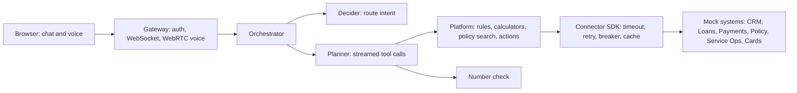

# Technical write-up

An AI assistant for loan servicing, by text and live voice, built as a small reusable
platform. Customers get answers about their own accounts, with every figure computed
by code and every rule cited. They can also complete service requests across
simulated enterprise systems. Credit cards are a second workflow added as a domain
pack, with no change to the platform code.

Detail: [architecture.md](architecture.md). Measurements:
[latency-report.md](latency-report.md) and [eval-report.md](eval-report.md).

## Architecture

For each message:

1. The **Decider** picks the intent, and with it the domain pack (loans or cards).
2. While it decides, the **planner** starts speculatively on the current pack, which
   hides most of the routing time.
3. Simple intents ("next EMI") are answered by code and a template. Everything else
   goes to the planner, which calls the pack's tools in parallel and streams its
   answer.
4. A **number check** ensures every figure in the answer came from a tool result.
5. Writes go through an **action framework**: confirm, OTP step-up, idempotent
   request, audit log.

**Voice** runs a Pipecat pipeline per call: WebRTC audio, voice activity detection,
Deepgram streaming speech-to-text, the same orchestrator, and Deepgram text-to-speech.
It supports barge-in (the customer talks over the assistant), filler lines while
slow systems answer, and spoken-style replies.

## Key decisions and trade-offs

| Decision | Why | Trade-off |
| --- | --- | --- |
| **Code computes, the model explains.** EMIs, prepayment savings, foreclosure quotes and card interest come from tested calculators; policies are executable rules with clause citations | Wrong figures are the most damaging error in lending. A number check blocks any figure no tool produced | Each product needs its rules and calculators written |
| **Retrieval (RAG) only for procedural policy questions.** Local Hugging Face embeddings (bge-small) in Chroma, cited passages | Covers the long tail ("can I change my EMI date?") without letting retrieved text decide customer-specific answers | FAQ documents must be kept current |
| **Own thin orchestrator,** no agent framework | Barge-in needs turn cancellation, plus speculative planning, streaming tool calls and write guards, all of which need fine control | About 800 lines of loop to maintain |
| **Decider plus speculative planner** | Routing picks the right pack and tools; speculation hides its latency | Discarded work when routing disagrees |
| **Domain packs as configuration:** tools, actions, intents, rules and prompts in YAML, plus optional pack functions | A second workflow (credit cards) was added without changing platform code | Packs need validation and clear documentation |
| **Open-weight models on free tiers,** with a failover chain: Qwen 3.8 27B on Cerebras first, then gpt-oss-120b on Groq and Cerebras | No cost for the demo. The same open models can be self-hosted in an Indian region for data residency | Free-tier limits; the chain fails over and waits for a cooling provider |
| **Mock systems as separate HTTP services** with injected latency and failures | Real network hops make timeouts, retries, circuit breakers and partial answers honest | More processes to run (one command starts them) |
| **Customer data from open sources where possible.** Generated customers replay real anonymised repayment and card histories (Home Credit), and the Decider benchmark uses real phrasings (BANKING77, Bitext) | More realistic behaviour and harder tests than hand-written data | The demo customers stay hand-built, since the journeys need specific scenarios |

Models were chosen on measurements, not reputation. On the same tests, Qwen 3.8 27B
beat gpt-oss-120b, OpenAI's GPT-5 mini and nano, and the dedicated decision model
TypeSafe JEV, which is kept as an optional Decider.

## Measurements

| What | Result |
| --- | --- |
| Answer accuracy | **67 of 69** golden questions correct on the live model, checked to the rupee, including questions about a loan and a card in one message; both misses are right in substance |
| Text turn time (live, free tier) | p50 **1.1 s**, p95 2.6 s; fast-path answers p50 0.35 s |
| Intent routing | 86.9% on 183 labelled decisions (65 real customer phrasings), p50 371 ms |
| Policy search | Right passage in the top 4 for 97.5% of paraphrased questions; off-topic questions retrieve nothing; about 7 ms per search |
| Scale (LLM replaced by a stub) | 1,000 concurrent conversations on 3 gateway processes: p95 turn 1.7 s, 0 errors; one process stays flat to 400 |
| Resilience | Payments outage: partial answers, circuit breaker opens after 2 failed turns, calls then fail fast, recovers automatically |
| Voice | Streaming speech-to-text works on a local machine in India; text-to-speech first audio byte p50 371 ms. In the sandbox (slower fallbacks), end of speech to first audio was 2.5-3.6 s and barge-in stopped audio in about 1.2 s |

## Limitations

- Routing still confuses some loan and card messages that name neither product, and
  fraud reports with disputes.
- End of speech to first audio on a real call is still to be measured locally.
- Free tiers can change without notice; production would self-host the models.
- `docker-compose.yml` is provided but untested; `poetry run poe up` is the tested
  way to run.
