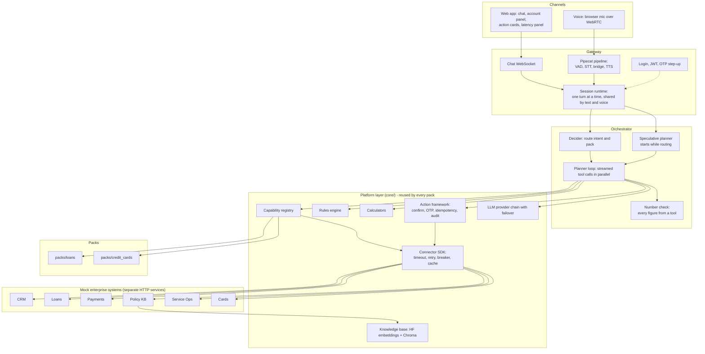

# Architecture and engineering decisions

AI loan servicing assistant for text and live voice, built as a small platform:
loan servicing is the first domain pack and credit cards the second, added
without changing the platform code. This document describes what is built and
why. Measured results are in [eval-report.md](eval-report.md) and
[latency-report.md](latency-report.md).

## System at a glance

## How one turn works

1. **Pending action?** If a request is waiting for confirmation, the reply is
   classified as yes, no, changed mind or unclear. A reply that asks something or
   adds a condition ("yes, but first...") never executes, whatever the model says.
2. **Route.** The Decider picks the intent across all packs, which selects the
   domain pack. In parallel, the planner starts **speculatively** on the
   conversation's current pack with its output held back. If routing agrees, the
   held output is released; otherwise it is cancelled. This hides most of the
   routing time.
   If the message also names another product ("my next EMI and my card's due
   amount"), or the Decider gives another pack's intents real weight, the turn
   plans once over **all those packs' tools**, each tool still running in its own
   pack with its own rules.
3. **Fast path.** High-confidence simple intents ("next EMI", "card minimum due")
   are answered by a pack function and a template, with no planner call
   (about 0.5 s end to end).
4. **Planner loop.** The planner sees only the active pack's tools (or the
   combined packs' tools, above). Tool calls
   are validated against their schema and run in parallel; up to 4 rounds.
   Text streams to the customer as it is generated.
5. **Number check.** Every figure in the answer must appear in a tool result,
   the customer's words or an earlier verified reply (rupee rounding allowed;
   identifiers such as loan ids are skipped). If not, the model gets one more
   round with tools to fetch the exact figures; if that also fails, the customer
   gets "I couldn't confirm the exact figures, so I won't guess" instead. If the
   model ends a turn with no text at all, it is asked once more to write the
   answer from the results it has; only then does the customer get a short "please
   ask again".
6. **Events.** Status, tokens, tool timings, action cards and the turn's trace
   go to every open client of the session (chat window and voice).

## Answer accuracy

- **The model plans and explains; code computes.** EMIs, prepayment savings,
  foreclosure quotes, minimum due and revolving interest come from tested
  calculators (`core/calculators.py`, pack-local card calculators).
- **Policies are executable rules.** `rules.yaml` in each pack is evaluated by a
  small, safe expression engine (`core/rules.py`); every verdict carries the
  clause that decided it, and the clause text comes from the Policy KB system.
  The prepayment rules follow the RBI Pre-payment Charges on Loans Directions,
  2025 (no charge on floating-rate loans to individuals, regardless of lock-in).
- **Pack functions combine data, rules and calculators** into one tool result
  (e.g. `explain_emi_change`, `explain_failed_payments`), so the model never has
  to join data or apply a rule itself.
- **Policy questions use retrieval (RAG).** Questions the rules do not cover
  ("can I change my EMI date?", "who do I complain to?", "am I liable for a fraud
  charge?") go to the `search_policy` tool of the active pack. See the next section.
- **Explainability.** Each answer has a "How I got this" panel: tools called with
  timings, rules applied, clauses cited, and whether the figures were verified.

## Policy retrieval (RAG)

`core/knowledge.py` is a platform capability served by the Policy KB system
(`GET /search/{pack}`, `GET /search`):

- **Documents:** every clause in `data/policy/*.yaml` and every `## [ID] Title`
  section of the FAQ files in `data/kb/*.md` (35 passages today) is one passage with a
  citable id. A document's `pack:` field puts it in that pack's collection, so a new
  pack gets retrieval by adding documents, without code changes.
- **Embeddings:** Hugging Face `BAAI/bge-small-en-v1.5` (384 dimensions), run locally
  on CPU through fastembed (ONNX). It needs no API key or paid service, and is
  downloaded once (65 MB).
- **Vector store:** Chroma, persistent on disk (`data/chroma`), one cosine
  collection per pack. The index is rebuilt automatically when a document or the model
  changes (a fingerprint is stored with the collection). Search takes about 8 ms.
- **Relevance:** passages below a similarity of 0.6, or more than 0.12 below the best
  hit, are dropped, so an off-topic question retrieves nothing and the assistant says
  it has no information rather than guessing. A clause id named in the question is
  returned first.
- **Scope check:** when the router calls a message out of scope, the orchestrator
  first searches every pack's documents; a strong match (0.62 or more) is answered
  from that pack. This catches policy questions that name no product ("my complaint
  is still open").
- **Grounding:** passages carry `id`, `title` and `text`, so they appear as cited
  clauses in "How I got this", and their figures count as evidence for the number
  check. Customer-specific figures still come only from the systems and calculators.

Measured on 40 paraphrased questions and 4 off-topic ones (`poe eval-rag`):
hit@1 87.5%, recall@4 97.5%, MRR 0.92, off-topic rejected 100%.

## Data

The mock systems run on a deterministic SQLite database (`data/seed.py`):

- **Three hand-built demo customers.** They carry the journeys' scenarios: a rate
  reset, failed payments with different causes, a fixed loan in lock-in and a duplicate
  card charge.
- **47 generated customers.** Their repayment behaviour replays real, anonymised
  instalment histories from the open Home Credit Default Risk data. For 15 of them,
  six months of credit-card behaviour does the same.
- **The Decider benchmark** includes 65 real customer phrasings from BANKING77 and
  Bitext retail banking.

Sources, licences and the mapping are in `data/open/README.md`.

## Real-time voice

`gateway/voice.py` runs a Pipecat pipeline per call: SmallWebRTC transport,
Silero VAD, speech-to-text, an `AssistantBridge`, text-to-speech. The bridge
drives the same session runtime as the chat, so a spoken question appears in the
chat window and an action raised by voice can be confirmed by clicking.

- Replies are spoken sentence by sentence while they stream; clause tags and
  symbols are cleaned for speech.
- A filler line ("Checking your payment history, one moment") plays when a slow
  system is called and nothing has been said yet.
- **Barge-in:** real words (streaming STT) or 0.8 s of sustained speech over the
  assistant stops the audio and cancels the turn, including LLM and backend calls.
  Short acknowledgements ("mm-hmm", "okay") do not interrupt.
- On voice, an out-of-scope result asks the customer to repeat, since it is
  usually a mis-heard word.
- Providers are configurable: Deepgram streaming STT and TTS by default; Groq
  Whisper and Deepgram HTTP TTS for networks that block WebSockets.

## Integrations and actions

- **Six mock systems** (CRM, Loans, Payments, Policy KB, Service Ops, Cards), each
  its own FastAPI app on its own port, with latency and failure rates set in
  `services/faults.yaml` and changeable at run time from the web app.
- **Connector SDK** (`core/connectors.py`): per-system timeouts, read retries with
  backoff and jitter, a circuit breaker per system, a per-customer cache, and a
  trace span per call. A system outage becomes a partial answer that says what
  could not be checked.
- **Action framework** (`core/actions.py`): every write goes propose -> confirm ->
  OTP step-up (per action; blocking a card skips it because it only reduces risk)
  -> idempotent request to Service Ops -> audit log entry, success or failure.

## Reusable platform capability

A **domain pack** is a folder: `tools.yaml`, `actions.yaml`, `decisions.yaml`,
`rules.yaml`, `prompt.md` and optional `functions.py` for pack-local logic. The
registry validates packs at start-up and routes intents across them.

The credit-card pack was added in one commit that **changed no file under
`core/`, `gateway/` or `web/`**: the pack folder, a mock Cards system, seed data,
policy clauses and tests (`git show --stat b4ab3f5`). It reuses the orchestrator,
Decider, speculative planner, connectors, rules engine, action framework, number
check, voice and web UI unchanged, and adds two card calculators of its own.

## Models and cost

| Role | Model | Notes |
| --- | --- | --- |
| Planner, Decider (LLM backend) and fast turns | Qwen 3.8 27B on Cerebras | Chosen on measured results: 64/66 golden questions at selection, 67/69 now (including questions spanning a loan and a card); Decider 86.9% on 183 decisions including 65 real customer phrasings, p50 371 ms; free limits of 450 requests a minute |
| Fallbacks | gpt-oss-120b on Groq and Cerebras, gpt-oss-20b on Groq, OpenRouter free model | Failover on 429/5xx/timeouts, cooldown after 429, wait for a cooling provider up to `LLM_MAX_WAIT_S` |
| Optional, paid | OpenAI GPT-5 mini (planner) and nano (Decider), provider `openai` | Tested once: 56/66 golden questions at p50 6-7 s per turn, so not in the default chain |
| Optional decision model | TypeSafe JEV 1.14, `DECIDER_BACKEND=jev` | 84.7% on the 183 decisions at p50 144 ms; input tokens only, about $0.00002 a decision |
| Development | Qwen3 8B / 4B on Ollama | Same OpenAI-compatible client |
| Speech | Deepgram Nova-3 and Aura-2 | Groq Whisper and Deepgram HTTP as fallbacks |

Everything runs on free tiers. The open-weight models can be self-hosted (vLLM)
inside the lender's own network in an Indian region, which is the production
answer for customer-data residency.

The Decider's keyword backend answers clear replies instantly and defers
otherwise; a model backend handles the rest. If the model's answer is unusable
(no JSON, broken JSON, an empty reply after long reasoning), the turn takes a safe
default instead of failing.

Two model backends sit behind the same interface: the LLM backend, which asks the
fast model for the likely options (at most 3) with probabilities, and TypeSafe JEV,
a dedicated decision model. If JEV is unreachable, the Decider falls back to the LLM
backend. JEV is twice as fast and never returns an unusable answer. It is not the
default because end to end it scored 61/66 against 64/66 for Qwen, and it was no
faster overall: the speculative planner already hides the Decider's time.
`evals/bench_decider.py` compares any backend on the same decisions.

## Security

- The customer id for every backend call comes from the session token, never from
  the model or the browser; the mock systems refuse records of another customer.
- Writes only through the action framework (confirmation, OTP, idempotency, audit).
- Rules files cannot run code (allow-listed expression evaluator, tested).
- JWT with a random per-run secret when none is configured.
- Unverified figures are never shown to the customer.

## Scale

The gateway and orchestrator are async; sessions are in memory by default or in
Redis (`REDIS_URL`) so several gateway processes can share them. Load-tested with
an LLM stub: one gateway process keeps latency flat to about 400 concurrent
conversations; three processes served **1,000 concurrent conversations with p95
turn time 1.7 s and no errors** (details in latency-report.md). Model capacity,
not the platform, is the constraint in production.

## Decisions and trade-offs

| Decision | Why | Cost |
| --- | --- | --- |
| Own thin orchestrator, no agent framework | Turn cancellation for barge-in, speculative planning, streaming tool calls and write guards need fine control | We maintain the loop (about 800 lines) |
| Rules as data + calculators for decisions; retrieval (RAG) for procedural policy questions | Customer-specific, exact, explainable answers; retrieval covers the long tail of policy text | Rules must be authored per product; FAQ documents must be kept current |
| Local Hugging Face embeddings (fastembed) + Chroma | Free, no key, no usage limit, data stays on the machine; Chroma persists and filters by pack | Small model (bge-small); swap for bge-m3 or a hosted vector DB at scale |
| Speculative planner during routing | Hides Decider latency | Discarded work when routing disagrees (fast paths, greetings) |
| Number check with a tool-enabled rewrite and a refusal fallback | Wrong figures are the most damaging error in lending | An occasional extra LLM round |
| Mock systems as separate HTTP services | Real network hops make latency and failure handling honest | More processes (one `poe up` command starts them) |
| Plain HTML/JS web app, no front-end framework | No Node build step on Windows; one less moving part | Less structure than a component framework |
| Platform package named `core/`, not `platform/` | `platform` shadows a Python standard module | - |
| Load test written in Python | Runs anywhere with the project's own dependencies | - |

## Known limitations

- gpt-oss-120b (now a fallback) calls tools one at a time even when parallel calls
  are allowed, so multi-part questions take extra planner rounds.
- Free tiers can change without notice; Cerebras' current Qwen limits (450 requests a
  minute) are unusually generous. The chain falls back to gpt-oss-120b on Groq and
  Cerebras, whose limits are much tighter (Groq: 8,000 tokens a minute per model).
- Intent routing confuses loan and card intents when a message names neither
  (e.g. "the June charge is wrong"); conversation context usually settles it.
  On real customer phrasings it also confuses fraud reports ("someone is using my
  card") with disputes.
- Spotting a second product relies on words each pack lists in `decisions.yaml`
  (`mentions`) and on the Decider's probabilities; a message that refers to a second
  product only indirectly may still be answered for one product.
- Voice was verified end to end in the sandbox on the HTTP fallbacks only. On a
  local machine in India, Deepgram streaming speech-to-text and text-to-speech both
  work (first audio byte p50 371 ms). Deepgram's servers are in the US, which adds
  about 200 ms per request from India. End-of-speech to first audio on a real call is
  still to be measured.
- `docker-compose.yml` is provided but untested (no Docker daemon in the build
  environment); `poetry run poe up` is the tested way to run.
